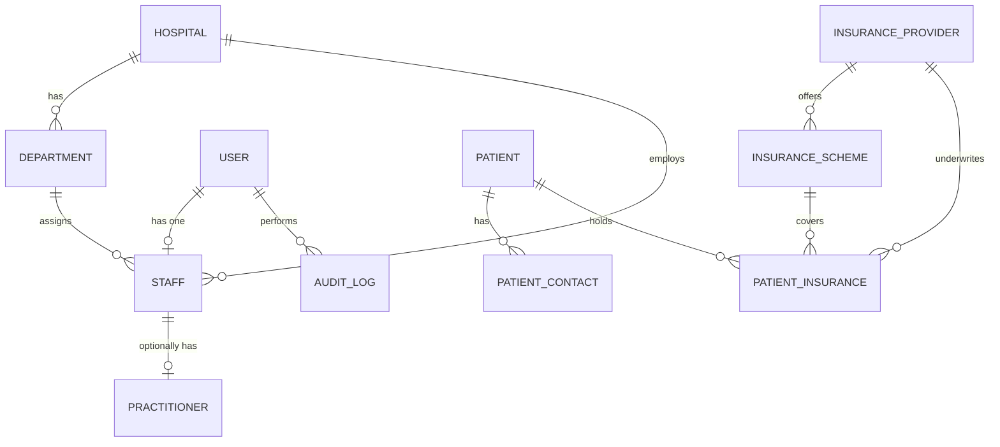

# Phase 1 — Database Foundation

This document describes the Phase 1 database foundation for the Hospital
Management System (HMS): the core tables, relationships, and identifier
conventions that every future clinical, laboratory, pharmacy, billing, and
insurance module builds on.

## Design principle: Staff vs Practitioner

> Every practitioner is staff, but not every staff member is a practitioner.

`staff` is the general employment entity for every hospital employee
(doctors, nurses, receptionists, accountants, IT officers, etc.).
`practitioners` is a specialized, optional one-to-one profile attached to a
staff record, created only for staff who provide clinical/professional
services. A staff member with no clinical role (receptionist, accountant,
IT officer, cleaner, security) simply has no `practitioners` row.

```
Staff #1 (Doctor)                -> has a Practitioner profile
Staff #2 (Nurse)                 -> has a Practitioner profile
Staff #3 (Receptionist)          -> no Practitioner profile
Staff #4 (Accountant)            -> no Practitioner profile
```

## Entity relationship diagram



## Tables

| Table | Purpose |
|---|---|
| `users` | System login accounts (Sanctum + Spatie roles/permissions live on top of this). |
| `hospitals` | One row per hospital/facility. Multi-hospital ready even though Phase 1 seeds a single hospital. |
| `departments` | Organizational units within a hospital (OPD, Emergency, Lab, Pharmacy, ...). |
| `staff` | Every hospital employee, clinical or not. |
| `practitioners` | Optional one-to-one clinical profile for staff who deliver professional/clinical services. |
| `patients` | Patient demographic and identity records. No insurance or NHIF fields live here. |
| `patient_contacts` | Emergency/next-of-kin contacts for a patient (a patient may have several). |
| `insurance_providers` | Government/private/corporate insurers (NHIF is just one row here, never hard-coded). |
| `insurance_schemes` | Named schemes/plans offered by a provider. |
| `patient_insurances` | Join of patient ↔ provider ↔ scheme, with membership/verification details. A patient may hold more than one, with at most one marked primary at a time. |
| `system_settings` | Key/value application configuration. Never stores secrets — those stay in `.env`. |
| `audit_logs` | Append-only trail of significant actions (`patient.created`, `staff.updated`, ...) via a polymorphic `auditable` relation. |

Roles and permissions are **not** modeled here — they come entirely from
`spatie/laravel-permission`'s own migrations (`roles`, `permissions`,
`model_has_roles`, `model_has_permissions`, `role_has_permissions`).

## Business identifiers vs database IDs

Every table with a business identifier keeps it fully separate from the
auto-incrementing primary key and from any future external system's ID:

| Table | Database ID | Business identifier |
|---|---|---|
| `patients` | `id` (17) | `patient_number` (`PT-2026-000017`) |
| `staff` | `id` (25) | `staff_number` (`STF-2026-000025`) |
| `practitioners` | `id` (8) | `practitioner_number` (`PRC-2026-000008`) |

Business numbers are generated in `App\Models\Concerns\GeneratesBusinessNumber`,
which produces a `{PREFIX}-{YEAR}-{SEQUENCE}` value per model on `creating`.
An external system's identifier (e.g. an NHIF practitioner ID) is **never**
stored on `staff` or `practitioners` directly — Phase 1 deliberately leaves
that to a future `insurance_practitioner_mappings`-style integration table,
per the architecture below.

## Insurance/NHIF boundary

```
HMS Core (patients, staff, practitioners)
   └── Insurance Domain (insurance_providers, insurance_schemes, patient_insurances)
          └── (future) NHIF / external integration mapping layer
                  └── NHIF API
```

No NHIF-specific columns exist anywhere in Phase 1. `insurance_providers.type`
distinguishes government/private/corporate/other so NHIF is just a seeded
row, not a schema concept.

## Migration order

1. `users` (+ soft deletes, `phone`, `status`)
2. Spatie permission tables, Sanctum `personal_access_tokens`
3. `hospitals`
4. `departments` (→ `hospitals`)
5. `staff` (→ `users`, `hospitals`, `departments`)
6. `practitioners` (→ `staff`)
7. `patients`
8. `patient_contacts` (→ `patients`)
9. `insurance_providers`
10. `insurance_schemes` (→ `insurance_providers`)
11. `patient_insurances` (→ `patients`, `insurance_providers`, `insurance_schemes`)
12. `system_settings`
13. `audit_logs` (→ `users`, polymorphic `auditable`)

## Duplicate patient detection

`patients` intentionally does **not** enforce uniqueness on `phone` or
`national_id` — both may legitimately be missing or shared (e.g. a shared
household phone). Duplicate detection is an application-level concern for a
future patient service, combining name, date of birth, gender, phone and
national ID rather than a DB constraint.

## Seed data

`php artisan migrate:fresh --seed` seeds:

- One hospital (`Main Hospital`) with 7 departments.
- 7 sample staff (doctor, nurse, pharmacist, lab technician, receptionist,
  accountant, IT officer), each with a linked user account.
- Practitioner profiles for the 4 clinical staff only — the receptionist,
  accountant and IT officer intentionally have none.
- Spatie roles (`super-admin`, `hospital-admin`, `doctor`, `nurse`,
  `pharmacist`, `laboratory-technician`, `receptionist`, `accountant`) with
  their permissions.
- Default `system_settings` (hospital identity, number prefixes, currency,
  timezone).
